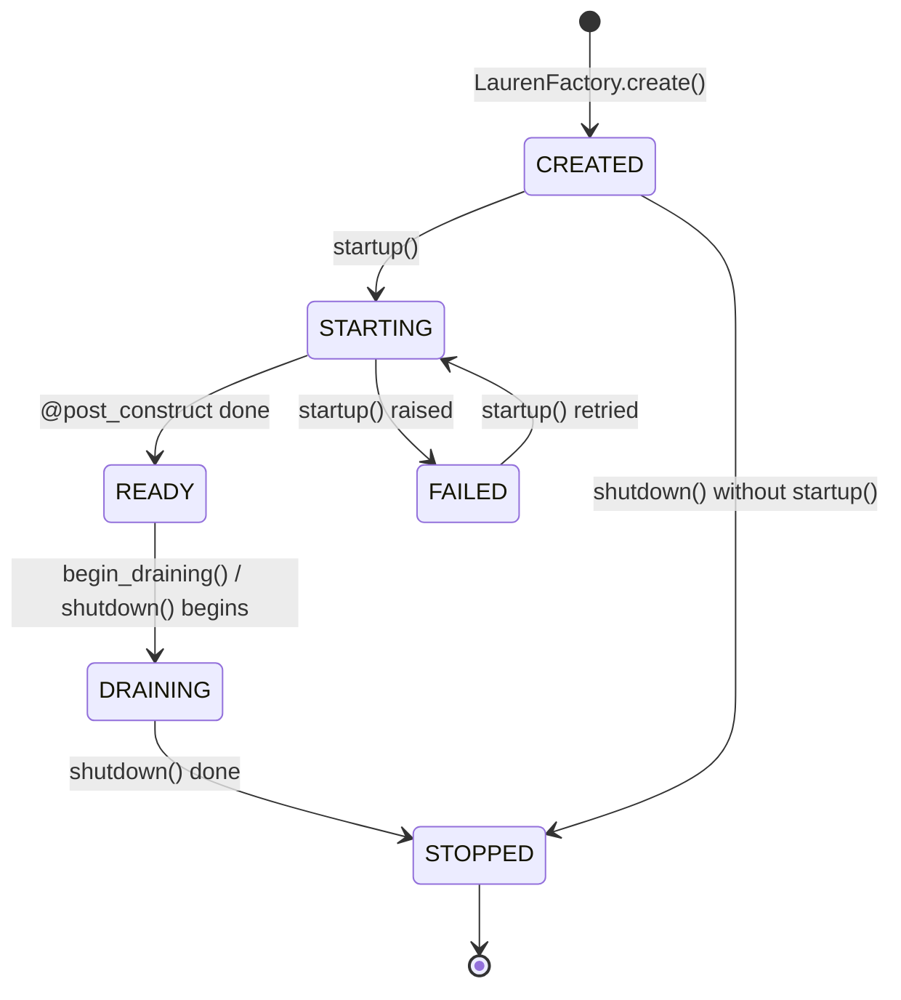

# Health, Readiness & Liveness Probes

> Kubernetes probes, load-balancer target checks and uptime monitors need to know two different things: *is this process broken?* (restart it) and *can it take traffic right now?* (route to it). Lauren answers both from its **lifecycle state** and from `@health_check` methods on your singletons, served by `HealthModule.for_root()`.

## Quick start

<!-- docs-contract: run -->
```python
from lauren import LaurenFactory, Scope, injectable, module
from lauren.health import HealthModule, HealthResult, health_check
from lauren.testing import TestClient


@injectable(scope=Scope.SINGLETON)
class Database:
    def __init__(self) -> None:
        self.reachable = True

    @health_check("database", timeout=2.0, cache_ttl=5.0)
    async def ping(self) -> bool:
        return self.reachable  # e.g. await self.pool.execute("SELECT 1")


@injectable(scope=Scope.SINGLETON)
class SearchClient:
    @health_check("search", critical=False, timeout=1.0)  # degrades, never fails readiness
    async def ping(self) -> HealthResult:
        return HealthResult.degraded(latency_ms=612.0, reason="slow")


@module(imports=[HealthModule.for_root()], providers=[Database, SearchClient])
class AppModule:
    pass


app = LaurenFactory.create(AppModule)
client = TestClient(app)  # runs startup(): the app is READY

assert client.get("/health/live").json() == {"status": "up"}
assert client.get("/health/ready").json() == {"status": "degraded"}  # 200: still in rotation

app.begin_draining(reason="preStop")  # termination announced
assert client.get("/health/ready").status_code == 503
assert client.get("/health/live").status_code == 200  # draining is not broken
```

`HealthModule.for_root()` serves four routes under `/health` (change it with `path=`):

| Endpoint | Purpose | Kubernetes |
|---|---|---|
| `GET /health/live` | the process works | `livenessProbe` |
| `GET /health/ready` | it can take traffic now | `readinessProbe` |
| `GET /health/startup` | startup has completed | `startupProbe` |
| `GET /health` | full report for humans and monitors | — |

## The lifecycle state

Every app exposes where it is in its lifetime as `app.lifecycle_state`, an `AppLifecycleState`:



* `STARTING` covers `startup()` — `@post_construct` hooks run here (triggered by the ASGI lifespan, or by `TestClient`).
* `DRAINING` means termination was requested: readiness fails, **requests are still served normally**. `app.begin_draining(reason="...")` enters it (it is synchronous, idempotent and returns `True` only when it changed the state); `shutdown()` enters it on its first line if nobody did earlier.
* `STOPPED` is terminal: `startup()` raises `LifecycleViolationError` once shutdown began (unless `strict_lifecycle=False`). `FAILED` lasts until `startup()` is retried — for example after an async configuration source recovered; a `FAILED` app stays `FAILED` after `shutdown()`.

Every transition emits a `LifecycleStateChanged(app, previous, current, reason)` on the app's `SignalBus`, so you can log it or drive your own integrations:

```python
from lauren import LifecycleStateChanged

@app.signals.on(LifecycleStateChanged)
def log_state(event: LifecycleStateChanged) -> None:
    print(f"{event.previous.value} -> {event.current.value} {event.reason}")
```

The state is useful without the health module too: a hand-written probe should answer from `app.lifecycle_state is AppLifecycleState.READY`, never a constant `{"status": "ok"}`.

## Probe semantics

| Endpoint | 200 when | 503 when |
|---|---|---|
| `/health/live` | the state is not `FAILED` / `STOPPED` and no `"live"`-tagged check is down | otherwise |
| `/health/startup` | the state is `READY` or `DRAINING` and no `"startup"`-tagged check is down | `CREATED`, `STARTING`, `FAILED`, `STOPPED` |
| `/health/ready` | the state is `READY` and no **critical** `"ready"`-tagged check is down | any other state, or a critical check down |
| `/health` | the aggregate is up or degraded | the aggregate is down (`report_status_code=False` keeps 200) |

Probes answer only `{"status": "up" | "degraded" | "down"}` — they never leak details. A degraded answer uses `degraded_status` (200 by default, so the instance stays in rotation).

The aggregate: any critical check down → `down`; otherwise any check down or degraded → `degraded`; otherwise `up`. In the report the lifecycle state counts as a critical check that is up only in `READY` (a draining instance reports `down`).

!!! warning "Liveness must not check dependencies"
    A database outage should take pods **out of rotation** (readiness), not **restart** them (liveness) — restarting every replica because a dependency is down turns a hiccup into an outage. Checks feed readiness by default; tag a check `"live"` only when its failure means *this process* is broken. The built-in liveness signals are the lifecycle state and, optionally, event-loop lag.

## Declaring checks

`@health_check(name, *, critical=True, timeout=2.0, cache_ttl=0.0, tags=("ready",))` marks a method of a **singleton** provider. Checks are discovered app-wide at startup — no registration call, no export needed — and resolved through their own provider's module.

* **Return value:** `None` / `True` → up, `False` → down, a `HealthResult` → as given (`HealthResult.up(**details)`, `.degraded(...)`, `.down(...)`); **raising** → down, with the exception as `error` in the report.
* **`critical=False`:** a down check degrades the report and readiness instead of failing them.
* **`tags`:** `"ready"`, `"live"`, `"startup"` — any combination, or `()` for report-only checks. Every check appears in the full report.
* **Sync methods** run in a worker thread under the same timeout.
* **Parameters:** none besides `self`, except dependencies the provider's module can resolve; request-scoped ones get a fresh scope per run (torn down afterwards).
* **Stacking** `@health_check` registers several checks on one method.

### Execution model

* All checks a probe needs run **concurrently**, each bounded by its `timeout` — a hung dependency never hangs the probe. A timeout is down with `reason: "timeout"`.
* **Single-flight:** concurrent probes share one in-flight run of each check.
* **Cache:** with `cache_ttl > 0` the last result is reused for that many seconds and marked `cached: true` — probe frequency × replicas no longer hits the dependency every time.
* A sync check that outlives its timeout keeps its thread (threads cannot be cancelled); until it returns, later runs fail fast with `"the previous run is still running"` instead of exhausting the thread pool.
* Each status change emits `HealthChanged(app, name, previous, current, details)` on the `SignalBus` (`name=None` for the report's aggregate) — feed it to logs or metrics.

## The report and the details policy

```json
{
  "status": "degraded",
  "lifecycle": "ready",
  "checks": {
    "database": {"status": "up", "critical": true, "latency_ms": 1.8, "cached": true},
    "search": {"status": "degraded", "critical": false, "latency_ms": 612.0, "reason": "slow"}
  },
  "version": "1.4.2"
}
```

Check names and statuses are always present. Everything else — `critical`, `latency_ms`, the check's details, `reason`, error messages — depends on `details=`:

| `details=` | What the report shows |
|---|---|
| `"never"` (default) | names and statuses only |
| `"always"` | everything (internal-only deployments, tests) |
| `"when_authorized"` | everything when `details_guard` allows the request, otherwise names and statuses — **never** a 403, so monitors keep working |

<!-- docs-contract: fragment -->
```python
HealthModule.for_root(details="when_authorized", details_guard=AdminGuard, version="1.4.2")
```

`details_guard` is an ordinary guard class (`async def can_activate(self, ctx) -> bool`), resolved through DI with the request's `ExecutionContext`. A guard that raises an `HTTPError` counts as a denial. Before startup completes, and after shutdown, the report runs no checks (`"checks": {}`).

`format="ietf"` answers `application/health+json` ([IETF draft](https://datatracker.ietf.org/doc/html/draft-inadarei-api-health-check)): statuses become `pass` / `warn` / `fail`, each check is a one-element list and errors appear as `output`.

## Built-in indicators

| Option | Check | Tags | Down when |
|---|---|---|---|
| `event_loop_lag_ms=500` | `event_loop` | `live`, `ready` | the p99 scheduling lag over the last 10 s exceeds the threshold (degraded above half). A sampler task measures it twice a second while the app is `READY`. |
| `disk_paths={"/": 1 << 30}` | `disk:<path>` | `ready` | `shutil.disk_usage(path).free` is below the minimum |
| `max_rss_bytes=2 << 30` | `memory` | `ready` | the resident set size exceeds the limit — current RSS on Linux, *peak* RSS (`ru_maxrss`) on other POSIX systems; not available on Windows |

All are off by default. Their names (`lifecycle`, `event_loop`, `memory`, `disk:*`) are reserved.

## Draining before the socket closes

Uvicorn stops listening and waits for open connections **before** it delivers `lifespan.shutdown`. By the time `shutdown()` flips readiness, nobody can observe it. Readiness has to fail *earlier* — while the server still accepts connections:

1. **Kubernetes (recommended): a `preStop` sleep.** Kubernetes removes a terminating pod from its endpoints by itself; a short `preStop` sleep covers the propagation delay. Readiness flipping is a bonus here.
2. **Lauren's signal handlers.** `install_signal_handlers(app, shutdown_delay=10)` calls `app.begin_draining()` on SIGTERM / SIGINT, keeps serving for `shutdown_delay` seconds — load balancers polling `/health/ready` (ALB, Nomad, Consul) see `DRAINING` — and then runs `app.shutdown()`.
3. **Your own runner.** A process that owns the server (for example a custom uvicorn `Server` loop) calls `app.begin_draining()` when it receives SIGTERM, waits, then triggers the server's graceful shutdown.

```yaml
containers:
  - name: api
    ports: [{containerPort: 8000}]
    startupProbe:
      httpGet: {path: /health/startup, port: 8000}
      periodSeconds: 2
      failureThreshold: 30        # up to 60 s for @post_construct
    livenessProbe:
      httpGet: {path: /health/live, port: 8000}
      periodSeconds: 10
    readinessProbe:
      httpGet: {path: /health/ready, port: 8000}
      periodSeconds: 5
    lifecycle:
      preStop:
        exec: {command: ["sleep", "5"]}
terminationGracePeriodSeconds: 30
```

## Global guards

A global authentication guard runs on every route, probes included. The probe routes carry the well-known `PUBLIC_METADATA_KEY` metadata, so a guard can let them through — the framework never skips a guard on its own:

<!-- docs-contract: fragment -->
```python
from lauren import PUBLIC_METADATA_KEY, ExecutionContext

class JwtGuard:
    async def can_activate(self, ctx: ExecutionContext) -> bool:
        if ctx.get_metadata(PUBLIC_METADATA_KEY, False):
            return True
        return verify(ctx.request.headers.get("authorization"))
```

Mark your own public routes the same way with `@set_metadata(PUBLIC_METADATA_KEY, True)`. The probe routes are also excluded from the OpenAPI document.

## Testing

`TestClient` starts the app, so probes answer as in production. Drive the state with `app.begin_draining()` / `await app.shutdown()`, swap in a provider whose check fails, and use `details="always"` to assert on the report:

<!-- docs-contract: run -->
```python
@injectable(scope=Scope.SINGLETON)
class UnreachableDatabase:
    @health_check("database")
    async def ping(self) -> bool:
        return False


@module(imports=[HealthModule.for_root(details="always")], providers=[UnreachableDatabase])
class TestModule:
    pass


test_client = TestClient(LaurenFactory.create(TestModule))

report = test_client.get("/health")
assert report.status_code == 503
assert report.json()["checks"]["database"]["status"] == "down"
assert test_client.get("/health/ready").status_code == 503
assert test_client.get("/health/live").status_code == 200  # a dependency outage never fails liveness
```

## Startup errors

| Error | Cause |
|---|---|
| `DecoratorUsageError` | `@health_check` without a name, a non-positive `timeout`, an unknown tag; an invalid `HealthModule.for_root` option |
| `LifecycleConfigError` | `@health_check` on a provider that is not a singleton (`detail`: `check`, `provider`, `method`, `scope`) |
| `DuplicateBindingError` | two checks share a name, or a check uses a built-in name (`detail["providers"]` names both) |
| `UnresolvableParameterError` | a check method has a parameter that is not a dependency of its provider's module |
| `GuardConfigError` | `details="when_authorized"` without `details_guard`, a guard without `can_activate`, or a guard with another policy |
| `StartupError` | `HealthModule.for_root()` imported with different options (`reason="conflicting_health_options"`) |
| `RouterConflictError` | two `HealthModule`s at the same path |

See the [reference](../reference/health.md) for signatures, and [Signals & Lifecycle Events](signals.md) for the `SignalBus`.
